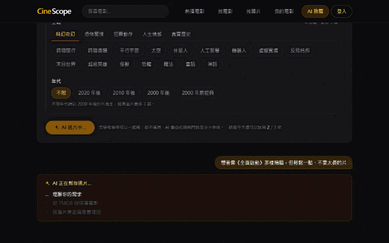
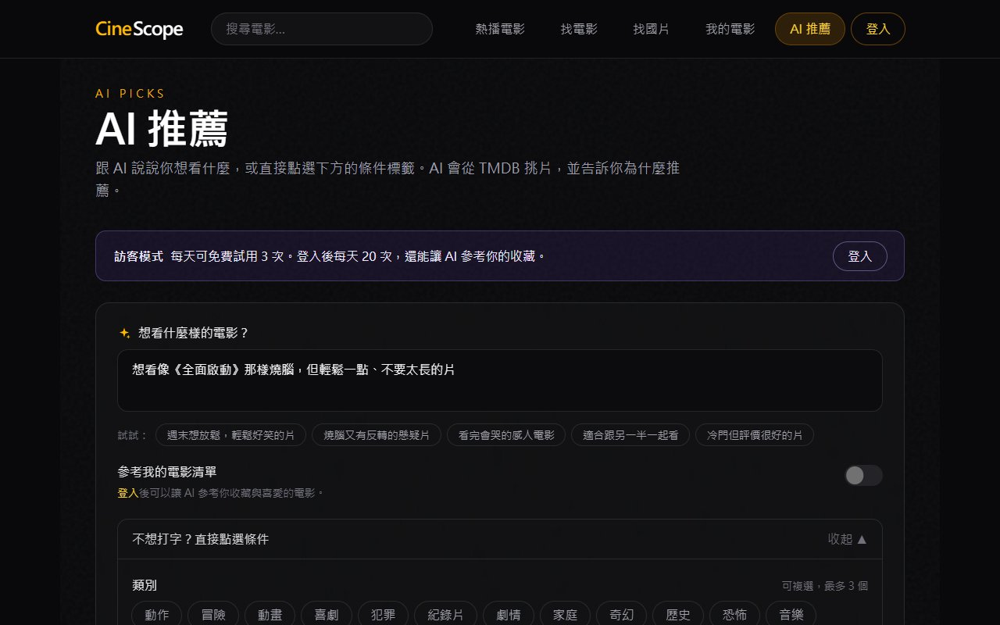
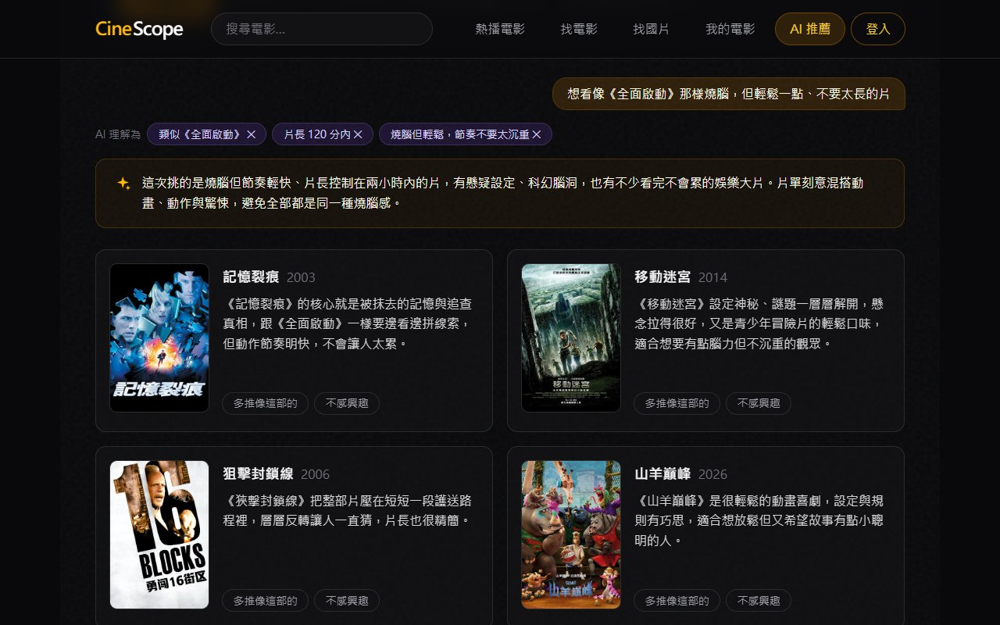
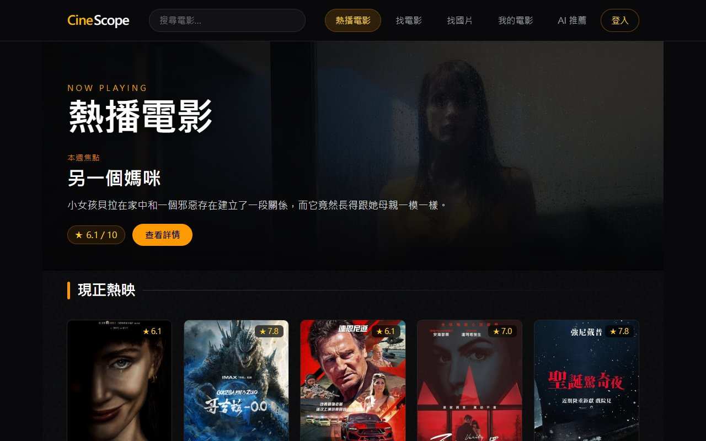
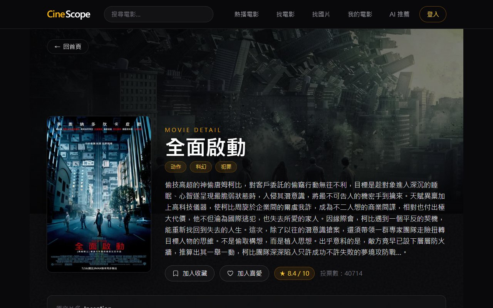
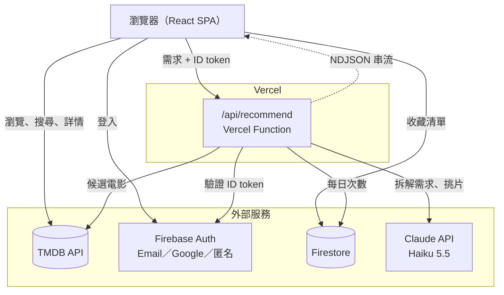
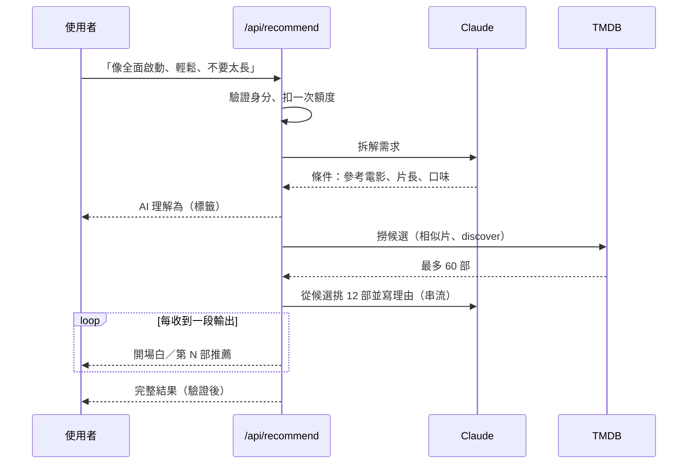

# CineScope

以 TMDB 為資料來源的電影探索網站，最大的特色是 **AI 選片人**：用一句話說出想看什麼，AI 會理解需求、從真實片庫中挑片，並說明每一部為什麼適合你。

**線上預覽：** [react-movie-app-five-kappa.vercel.app](https://react-movie-app-five-kappa.vercel.app)
**AI 推薦免註冊試用：** [/recommend](https://react-movie-app-five-kappa.vercel.app/recommend) → 按「免登入試用」（訪客每天 3 次）



## 目錄

- [功能](#功能)
- [AI 推薦的設計](#ai-推薦的設計)
- [系統架構](#系統架構)
- [開發紀錄：遇到的問題與解法](#開發紀錄遇到的問題與解法)
- [其他工程細節](#其他工程細節)
- [技術棧](#技術棧)
- [本地開發](#本地開發)

## 功能

| AI 推薦：用一句話描述需求 | AI 推薦：理解的條件與推薦理由 |
|---|---|
|  |  |
| **首頁：台灣近期上映** | **電影詳情** |
|  |  |

- **AI 推薦**：一句話描述想看的片，或直接點選類別、76 個主題、年代標籤；結果可以繼續對話微調（「更輕鬆一點」「多一點亞洲片」）、多推相似片、標記不感興趣、再推薦一批
- **找電影／找國片**：依年份、類別、排序探索片單，條件與頁碼存在網址，可分享、可返回
- **搜尋**：關鍵字搜尋，含分頁
- **電影詳情**：簡介、評分、卡司、預告片、台灣串流平台
- **人物頁**：演員作品列表
- **帳號**：Email／Google 登入、忘記密碼、信箱驗證提醒
- **我的電影**：收藏與喜愛清單，同步至 Firestore

## AI 推薦的設計

### 1. 推薦的電影一定真的存在

直接請 AI「推薦幾部電影」，常會得到片名寫錯、對不上資料庫，甚至不存在的電影。CineScope 改成兩段式：

1. **後端先從 TMDB 撈出最多 60 部候選片**（依需求用 discover、相似片推薦或熱門片）。
2. **AI 只能從候選中挑選並寫理由**，回傳格式用 JSON Schema 固定；後端再驗證每個 id 都在候選池裡，才送到前端。

### 2. 把一句話拆解成看得見、改得動的條件

「想看像《全面啟動》那樣燒腦，但輕鬆一點、不要太長的片」會先由 AI 拆解成結構化條件：

| 使用者說的 | 拆解成 | 實際用途 |
|---|---|---|
| 像《全面啟動》 | 參考電影（TMDB 搜尋轉成 id） | 用它的相似片當候選，排序優先 |
| 不要太長 | 片長 120 分鐘內 | TMDB `with_runtime.lte`，種子片逐部查片長 |
| 燒腦但輕鬆 | 口味偏好 | 交給 AI 挑片時參考 |
| 多一點亞洲片（微調） | 日、韓、華、粵、泰語 | TMDB `with_original_language` |

拆解結果會以「**AI 理解為**」標籤顯示在畫面上，理解錯了可以直接點掉，用修正後的條件重新推薦（不需要再呼叫 AI 拆解）。不想打字的人也可以直接點選標籤，兩者可以並用。

### 3. 串流：約 3 秒就看到第一張卡片

整個流程（拆解需求 → 撈候選 → AI 挑 12 部並寫理由）要 8–15 秒，一次等完體驗很差。後端改用 **NDJSON 串流**，把進度、拆解出的條件、開場白、每一部推薦逐行送出：

- AI 的輸出是一段 JSON，後端**邊接收邊解析還沒結束的 JSON**，開場白與每部片的理由一出現就送到前端，前端以打字效果呈現、卡片逐張淡入。
- 最後以完整 JSON 重新驗證一次，確保串流途中顯示的與最終結果一致。
- 結果：約 0.3 秒出現進度、約 2 秒出現「AI 理解為」、約 3–5 秒出現第一張卡片。

### 4. 成本與濫用控制

| 機制 | 做法 |
|---|---|
| 選用合適的模型 | Claude Haiku 5.5，一次推薦約 US$0.002–0.003 |
| 每日次數限制 | 一般帳號每天 20 次；在呼叫 AI **之前**以 Firestore transaction 扣次數，同時多個請求也不會超用 |
| 訪客試用 | Firebase 匿名登入免註冊試用，每人每天 3 次；匿名帳號可以無限建立，所以**所有訪客合計每天再設 100 次上限**，把訪客成本封頂在約 US$0.3／天 |
| 失敗退還 | 伺服器、TMDB 或 AI 服務端出錯時退還次數；找不到片、AI 拒答照常計算，避免被刻意失敗的請求白用 |
| 設定漏掉時一律擋下 | 缺少服務帳戶金鑰時，非白名單帳號一律拒絕，而不是放行 |
| 防連點 | 同一時間只允許一個請求 |

### 5. 安全

- `ANTHROPIC_API_KEY` 與 Firebase 服務帳戶金鑰只存在伺服器端環境變數，前端打包檔中不含任何金鑰。
- 每個 API 請求都以 `jose` 驗證 Firebase ID token（Google 公開金鑰、issuer、audience）。
- 使用次數存在前端安全規則**完全沒開放**的集合，只有後端服務帳戶能讀寫，使用者無法竄改。
- 前端送來的條件、清單、排除名單都經過白名單與長度驗證。
- 關閉「參考我的電影清單」時，清單完全不會傳到後端。

### 6. 讓推薦結果更好

- **每次結果不同**：種子片、TMDB 頁數、候選排序都加入隨機性；同條件連續推薦兩次，12 部中只有約 3 部重複。
- **老片比例**：年代「不限」時，候選中 2000 年前的片最多 25%，最後片單最多 3 部（程式強制，不只靠提示詞）。
- **多主題平均**：選多個主題時每個主題分開撈候選再交錯合併，避免熱門主題（如喪屍）把其他主題擠掉。
- **再推薦一批**：已推薦過與標記不感興趣的片會被排除，不感興趣的片名也會讓 AI 避開相近風格。

## 系統架構



AI 推薦一次請求的流程：



## 開發紀錄：遇到的問題與解法

| 問題 | 原因 | 解法 |
|---|---|---|
| 每次推薦都是固定那幾部 | 候選來源與排序是固定的 | 種子片、頁數、排序加入隨機性；再推薦時排除已推薦過的片 |
| 有時整頁都是 2000 年前的老片 | 提示詞要求「年代混搭」，AI 解讀成多挑經典 | 新增年代選項；「不限」時由程式限制老片比例與數量，並請 AI 多挑 2 部備用以補滿 12 部 |
| 選「喪屍＋友情」結果 11 部都是喪屍片 | 多個主題用「任一符合」一起查，熱門主題占滿前幾頁 | 每個主題各自撈候選再交錯合併 |
| 說「像《全面啟動》」，AI 卻加上「時間旅行」主題 | AI 自行從參考電影推測條件，而且推測錯了 | 規則：有參考電影時只記錄參考電影，相似度交給 TMDB 推薦 |
| 要等 12–15 秒才一次出現全部結果 | 一般 API 回應要等 AI 整段輸出完 | 改成 NDJSON 串流，後端邊收邊解析 JSON |
| 快速連點時同時送出兩個請求，片單出現重複 | 按鈕停用要等下一次畫面更新才生效 | 以 `useRef` 記錄請求中狀態，進行中的請求一律擋下 |
| 面試官不會為了試用而註冊帳號 | AI 推薦需要登入 | Firebase 匿名登入免註冊試用，搭配個人與總量兩層額度 |

## 其他工程細節

- **依路由拆分程式碼**：各頁面 lazy load、react 與 firebase 拆成獨立 chunk，首次載入的主程式從 641 KB 降到約 12 KB。
- **網址即狀態**：找電影的篩選條件、搜尋關鍵字與頁碼都存在網址，重新整理或返回時會還原；電影詳情頁的「返回」會依來源頁面顯示對應文字。
- **本機也能跑 Vercel Functions**：自訂 Vite plugin，讓 `npm run dev` 直接執行 `api/` 底下的 Web 標準 handler（含串流），不需要 Vercel CLI。
- **響應式**：1024px 以下改用漢堡選單，主題標籤依分組以分頁切換。
- **尊重系統設定**：卡片淡入、打字游標等動畫在「減少動態效果」開啟時不播放。

## 技術棧

| 分類 | 使用技術 |
|---|---|
| 前端 | React 19、React Router 7、Tailwind CSS 4、Vite 8 |
| 後端 | Vercel Functions（Node.js、Web 標準 Request／Response、NDJSON 串流） |
| AI | Anthropic SDK、Claude Haiku 5.5（結構化輸出、串流） |
| 資料 | TMDB API、Firebase Auth、Firestore、firebase-admin |
| 安全 | jose（驗證 Firebase ID token）、Firestore 安全規則 |
| 部署 | Vercel |

## 本地開發

```bash
npm install
npm run dev
```

複製 `.env.example` 為 `.env` 並填入：

| 變數 | 用途 | 位置 |
|---|---|---|
| `VITE_TMDB_API_KEY` | TMDB API | 前端（後端也會沿用） |
| `VITE_FIREBASE_*` | Firebase 專案設定 | 前端 |
| `ANTHROPIC_API_KEY` | AI 推薦 | 僅伺服器端，不可加 `VITE_` 前綴 |
| `FIREBASE_SERVICE_ACCOUNT` | 讀寫每日次數（服務帳戶金鑰的 base64） | 僅伺服器端 |
| `AI_UNLIMITED_EMAILS` | 不受次數限制的帳號（逗號分隔，需已驗證） | 僅伺服器端 |

`npm run dev` 會一併提供 `/api` 路由。訪客試用需要在 Firebase 主控台啟用「匿名」登入。
